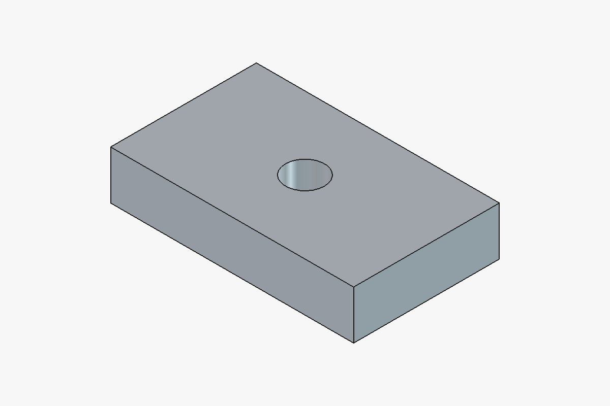

# FreeCAD with MCP

Novos geradores: [conjunto de engrenagens com dois eixos, caixa e tampa](freecad-mcp/cess_gui/GEAR_SETS.md), configurado por relação entrada:saída, e [parafuso/porca com cabeça Allen ou sextavada e rosca 3D real](freecad-mcp/cess_gui/FASTENERS.md). Ambos têm janela de parâmetros e ferramentas MCP nos dois transportes.

Dois transportes compartilham as mesmas 36 ferramentas: **STDIO** para Codex/VS Code e **Streamable HTTP autenticado** para clientes remotos. O HTTP usa localhost por padrão; a preparação para ChatGPT Web inclui OAuth externo e Secure MCP Tunnel, sem publicação automática. Consulte [instalação, segurança e integração com ChatGPT](freecad-mcp/docs/TRANSPORTS.md).

Integração local para controlar o FreeCAD por linguagem natural usando Codex e o protocolo MCP. Para Windows, com 36 ferramentas para documentos, sólidos, booleanas, transformações, inspeção, geradores, exportação e captura da vista.

Inclui também a barra **CESS — Desenho**, com os botões **Centralizar**, **Colocar cotas** e **Inserir texto**. [Como usar a barra](freecad-mcp/cess_gui/README.md).

A barra **CESS — Geradores** acrescenta **Engrenagem**, **Caixa com tampa**, **Letra caixa**, **Numeros caixa** e **Organizador**, com diálogos e parâmetros editáveis no documento. [Instruções dos geradores](freecad-mcp/cess_gui/GENERATORS.md).

| Gerador | Exemplo FCStd | Prévia |
|---|---|---|
| Conjunto com caixa e tampa | [Redução 2:1](modelos/conjuntos_engrenagens/reducao_2_1.FCStd) | [Imagem](modelos/conjuntos_engrenagens/reducao_2_1.png) |
| Parafuso Allen e porca | [Abrir modelo](modelos/parafusos_porcas/allen.FCStd) | [Imagem](modelos/parafusos_porcas/allen.png) |
| Engrenagem evolvente | [Abrir modelo](modelos/geradores/gear.FCStd) | [Imagem](modelos/geradores/gear.png) |
| Caixa com tampa e guia | [Abrir modelo](modelos/geradores/box.FCStd) | [Imagem](modelos/geradores/box.png) |
| Letras caixa ocas | [Abrir modelo](modelos/geradores/letters.FCStd) | [Imagem](modelos/geradores/letters.png) |
| Números caixa ocos | [Abrir modelo](modelos/geradores/numbers.FCStd) | [Imagem](modelos/geradores/numbers.png) |
| Organizador com divisórias | [Abrir modelo](modelos/geradores/organizer.FCStd) | [Imagem](modelos/geradores/organizer.png) |

Cada exemplo também tem STEP e STL na mesma pasta.



## Requisitos

- Windows com FreeCAD instalado; validado com FreeCAD 1.1.1 de 64 bits.
- Python 3.11 ou superior para o servidor; validado com Python 3.12.10.
- Codex CLI/VS Code para usar o servidor como ferramentas do assistente.

Não é necessário clonar ou compilar o código-fonte do FreeCAD. O servidor roda em ambiente virtual separado do Python embarcado do FreeCAD.

## Instalação

```powershell
git clone https://github.com/drigocodeup/FREECAD_WITH_MCP.git
cd FREECAD_WITH_MCP
powershell.exe -NoProfile -ExecutionPolicy Bypass -File .\freecad-mcp\scripts\install.ps1
```

Confira o caminho do FreeCAD em `freecad-mcp/config/settings.json`; o padrão é `C:/Program Files/FreeCAD 1.1/bin/freecad.exe`.

Inicie o bridge:

```powershell
powershell.exe -NoProfile -ExecutionPolicy Bypass -File .\freecad-mcp\scripts\start.ps1
```

Também é possível abrir com `Iniciar_FreeCAD_CESS.cmd`. O lançador carrega a barra de desenho na aplicação instalada, sem compilar as fontes do FreeCAD.

Se FreeCAD já estiver aberto, o script informa a macro a executar pelo menu **Macro > Macros**, preservando a instância existente.

Registre o servidor com os caminhos absolutos da sua cópia:

```powershell
$McpProject = (Resolve-Path .\freecad-mcp).Path
codex mcp add freecad_local -- "$McpProject\.venv\Scripts\python.exe" "$McpProject\server.py"
codex mcp list
```

Abra uma nova sessão Codex para atualizar o catálogo e solicite:

> Use freecad_local para consultar o estado do FreeCAD. Crie uma caixa de 100 × 60 × 20 mm com furo passante central de diâmetro 16 mm. Valide um sólido e salve FCStd, STEP e STL na pasta modelos.

## Arquitetura

`Codex → MCP STDIO → bridge local autenticado → thread principal Qt do FreeCAD → Part/OCCT → arquivos`.

O bridge aceita somente operações permitidas, sem execução arbitrária de Python. Escuta exclusivamente em loopback; o token fica em `.runtime`, protegida por ACL no Windows e excluída do Git. Gravações são restritas à pasta `modelos`, sem sobrescrita por padrão.

## Validação

Na execução local registrada: **14 testes aprovados e 1 ignorado** por privilégio Windows de link simbólico. A integração foi testada com chamadas MCP reais, incluindo salvar, fechar e reabrir a peça.

- Volume teórico: **115978,76140340506 mm³**.
- Volume medido após reabrir: **115978,76140340508 mm³**.
- STEP reimportado: um sólido válido.
- STL reimportado: malha fechada com 520 facetas; volume aproximado por triangulação.

Arquivos demonstrativos em [modelos](modelos). Evidências: [relatório de integração](freecad-mcp/integration-result.json), [validação das exportações](freecad-mcp/export-validation.json) e [resultado dos testes](freecad-mcp/test-results.xml). Caminhos locais foram substituídos por marcadores para publicação.

A extensão de desenho tem validação adicional: **17 testes aprovados e 3 ignorados** na bateria comum (integração CAD desligada e privilégio de link simbólico ausente), mais smoke test em uma instância gráfica real. O smoke test verificou centralização, desfazer/refazer, cota de 100 mm, texto e os comandos interativos. [Evidência da GUI](freecad-mcp/gui-validation.json).

Na bateria completa após adicionar os geradores: **47 testes aprovados e 1 ignorado**, incluindo chamadas MCP reais aos cinco geradores. Os testes gráficos, geométricos e de persistência também passaram. As exportações dos cinco modelos foram reimportadas: STEP com todos os sólidos preservados e STL com malhas fechadas. [Resultado pytest](freecad-mcp/generators-test-results.xml) · [Geometria e persistência](freecad-mcp/generators-geometry-validation.json) · [GUI](freecad-mcp/generators-gui-validation.json) · [Exportações](freecad-mcp/generators-export-validation.json) · [MCP](freecad-mcp/generators-mcp-validation.json).

Para executar os testes:

```powershell
cd freecad-mcp
.\.venv\Scripts\python.exe -m pytest
# Com o bridge real aberto:
$env:FREECAD_INTEGRATION='1'
.\.venv\Scripts\python.exe -m pytest -q
```

Os testes de integração criam arquivos locais novos. Não exigem nem enviam dados para serviços de IA; o transporte entre MCP e FreeCAD é local.

## Escopo e evolução

V1 implementa sólidos Part, FCStd, STEP, STL e PNG. A extensão de interface acrescenta centralização entre objetos independentes e acesso às ferramentas Draft de cotas e texto na vista do modelo. Desenhos TechDraw cotados, centralização de geometrias dentro do mesmo esboço e CAM/G-code ainda não estão implementados.

Consulte [instruções detalhadas](freecad-mcp/README.md), [diagnóstico da execução](freecad-mcp/DIAGNOSTICO.md) e [próximas melhorias](ROADMAP.md).
